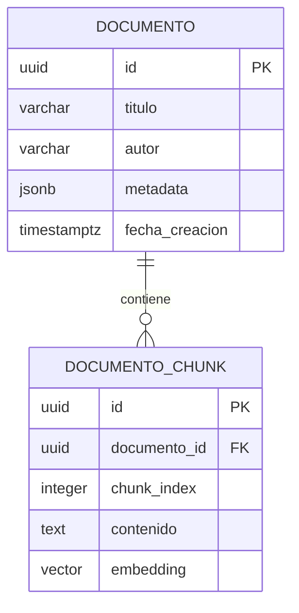

# 🐘 PostgreSQL + pgvector: Normalización, Arquitectura y Búsqueda Semántica

PostgreSQL destaca por su cumplimiento estricto de los estándares ACID, extensibilidad mediante tipos personalizados y capacidades híbridas de base de datos relacional y vectorial (*Vector Database*) gracias a la extensión **`pgvector`**.

---

## 🧠 1. ¿Qué es pgvector y para qué sirve?

`pgvector` es una extensión de código abierto para PostgreSQL que permite almacenar vectores densos de alta dimensión (*embeddings*) generados por modelos de Inteligencia Artificial (OpenAI, Gemini, HuggingFace, Mistral, Ollama) y realizar búsquedas de similitud en tiempo real mediante índices vectoriales especializados.

### 1.1 Habilitación de la Extensión
```sql
-- Requiere privilegios de superusuario o permisos CREATE en la BD
CREATE EXTENSION IF NOT EXISTS vector;
```

### 1.2 Dimensiones Frecuentes según el Modelo de Embedding
| Modelo / Proveedor | Dimensión | Tipo de Dato en PostgreSQL | Caso de Uso |
| :--- | :--- | :--- | :--- |
| **All-MiniLM-L6-v2** | 384 | `vector(384)` | RAG ligero, local y veloz |
| **Google Vertex / text-embedding-004** | 768 | `vector(768)` | Embeddings multilingües equilibrados |
| **OpenAI text-embedding-3-small** | 1536 | `vector(1536)` | Producción estándar para LLMs |
| **OpenAI text-embedding-3-large** | 3072 | `vector(3072)` | Alta precisión semántica |

---

## 📐 2. Estrategia y Normalización para pgsql + pgvector

Existe un conflicto arquitectónico fundamental entre el modelo relacional tradicional y el almacenamiento vectorial: **el tamaño físico de los embeddings**.

### ⚠️ El Problema de la Columna Vectorial en la Tabla Principal (Antipatrón)
- Un vector de 1536 floats de 32 bits consume aproximadamente **6 KB por fila** (más metadatos de página).
- Si colocas la columna `vector(1536)` dentro de la tabla `articulos(id, titulo, autor, cuerpo, fecha, embedding)`:
  - Las páginas de disco de PostgreSQL (8 KB por bloque) solo podrán albergar 1 fila por página.
  - Cuando una consulta OLTP estándar ejecute `SELECT id, titulo FROM articulos WHERE autor_id = 5;`, el motor tendrá que leer gigabytes innecesarios de vectores en memoria RAM (`shared_buffers`), destruyendo la caché del servidor y degradando el rendimiento de lectura hasta en un 80%.

---

### 🏆 2.1 Patrón 1: Tabla Normalizada de Chunks 1:N (Recomendado para RAG)

En aplicaciones de **Retrieval-Augmented Generation (RAG)**, un documento extenso debe dividirse en fragmentos semánticos (*chunks*). 

Este diseño cumple con la **Tercera Forma Normal (3FN)** y separa el almacenamiento ligero de metadatos del almacenamiento pesado de vectores:



#### DDL Implementado:
```sql
-- 1. Tabla de Documentos (Metadatos ligeros, transaccional, 3FN)
CREATE TABLE documentos (
    id UUID PRIMARY KEY DEFAULT gen_random_uuid(),
    titulo VARCHAR(255) NOT NULL,
    autor VARCHAR(100) NOT NULL,
    metadata JSONB DEFAULT '{}'::jsonb,
    created_at TIMESTAMPTZ NOT NULL DEFAULT CURRENT_TIMESTAMP,
    updated_at TIMESTAMPTZ NOT NULL DEFAULT CURRENT_TIMESTAMP
);

-- 2. Tabla de Chunks y Embeddings (Carga vectorial aislada)
CREATE TABLE documento_chunks (
    id UUID PRIMARY KEY DEFAULT gen_random_uuid(),
    documento_id UUID NOT NULL,
    chunk_index INT NOT NULL,
    contenido TEXT NOT NULL,
    embedding VECTOR(1536) NOT NULL,
    CONSTRAINT FK_Chunk_Documento FOREIGN KEY (documento_id) 
        REFERENCES documentos(id) ON DELETE CASCADE,
    CONSTRAINT UQ_Documento_Chunk UNIQUE (documento_id, chunk_index)
);

-- Índice relacional B-Tree para JOINs ultra rápidos
CREATE INDEX idx_chunks_documento_id ON documento_chunks(documento_id);

-- Índice GIN para filtrado avanzado por metadatos JSONB
CREATE INDEX idx_documentos_metadata ON documentos USING GIN(metadata);
```

---

### 🛡️ 2.2 Patrón 2: Particionamiento Vertical 1:1 (Para Entidades Atómicas)

Si cada entidad posee exactamente un único vector (por ejemplo, el catálogo de productos de un e-commerce o perfiles de clientes):

```sql
-- Tabla principal de negocio (rápida para listar y transaccionar)
CREATE TABLE productos (
    id BIGINT GENERATED ALWAYS AS IDENTITY PRIMARY KEY,
    sku VARCHAR(50) UNIQUE NOT NULL,
    nombre VARCHAR(200) NOT NULL,
    precio NUMERIC(10, 2) NOT NULL,
    stock INT NOT NULL DEFAULT 0
);

-- Tabla vertical de embeddings (aislada del buffer pool regular)
CREATE TABLE producto_embeddings (
    producto_id BIGINT PRIMARY KEY,
    embedding VECTOR(1536) NOT NULL,
    actualizado_el TIMESTAMPTZ NOT NULL DEFAULT CURRENT_TIMESTAMP,
    CONSTRAINT FK_Embedding_Producto FOREIGN KEY (producto_id) 
        REFERENCES productos(id) ON DELETE CASCADE
);
```

---

### 💡 2.3 Distinción Crítica: Normalización Relacional vs Normalización Matemática

> [!IMPORTANT]
> **No confundir los dos términos:**
> 1. **Normalización Relacional (1FN, 2FN, 3FN):** Estructurar tablas para evitar redundancia funcional.
> 2. **Normalización Vectorial (Álgebra Lineal):** Ajustar la longitud euclidiana del vector a 1 ($\|v\| = 1$).
>    - Si normalizas los embeddings en la aplicación antes de insertarlos a la base de datos, la **Distancia Coseno** se vuelve idéntica al **Producto Punto** ($u \cdot v$).
>    - El operador de producto punto (`<#>`) es computacionalmente mucho más rápido que la distancia coseno (`<=>`), lo que acelera las búsquedas a gran escala.

---

## 🎯 3. Métricas de Distancia en pgvector

| Operador | Métrica de Similitud | Fórmula Matemática | Caso de Uso Óptimo |
| :---: | :--- | :--- | :--- |
| `<->` | **Distancia Euclidiana ($L_2$)** | $\sqrt{\sum (u_i - v_i)^2}$ | Coordenadas espaciales, visión artificial |
| `<#>` | **Producto Punto Negativo** | $-(u \cdot v) = -\sum u_i v_i$ | Embeddings ya normalizados a norma unitaria |
| `<=>` | **Distancia Coseno** | $1 - \frac{u \cdot v}{\|u\| \|v\|}$ | Procesamiento de Lenguaje Natural (NLP), semántica de textos |

---

## ⚡ 4. Índices Vectoriales: HNSW vs IVFFlat

### 4.1 Índice HNSW (Hierarchical Navigable Small World) - *Estándar de Oro*
Construye un grafo multicapa navegable. Es el índice recomendado para producción:

```sql
CREATE INDEX idx_chunks_embedding_hnsw 
ON documento_chunks 
USING hnsw (embedding vector_cosine_ops)
WITH (m = 16, ef_construction = 64);
```

- **`m`:** Número máximo de conexiones por capa (8 a 64, default 16).
- **`ef_construction`:** Tamaño de la lista de candidatos durante la construcción (default 64). Mayor valor aumenta la precisión pero tarda más en indexar.
- **Ajuste en caliente de precisión de búsqueda:**
  ```sql
  SET hnsw.ef_search = 100; -- Mayor número = mayor precisión (recall) a cambio de leve latencia
  ```

### 4.2 Índice IVFFlat (Inverted File Flat)
Divide el espacio vectorial en listas/clusters Voronoi. Consume menos memoria pero requiere que la tabla ya contenga datos representativos antes de construirse:

```sql
CREATE INDEX idx_chunks_embedding_ivfflat 
ON documento_chunks 
USING ivfflat (embedding vector_cosine_ops)
WITH (lists = 100); -- Heurística: sqrt(total_filas)
```

---

## 🔍 5. Consultas Prácticas: Búsqueda Semántica e Híbrida

### 5.1 Búsqueda Semántica Pura (Top 5 más similares)
```sql
SELECT 
    d.titulo,
    c.chunk_index,
    c.contenido,
    1 - (c.embedding <=> '[0.012, -0.045, ... , 0.089]'::vector) AS similitud_coseno
FROM documento_chunks c
INNER JOIN documentos d ON c.documento_id = d.id
ORDER BY c.embedding <=> '[0.012, -0.045, ... , 0.089]'::vector ASC
LIMIT 5;
```

### 5.2 Búsqueda Híbrida (Hybrid Search: Full Text Search + Embeddings con RRF)
Combina el motor léxico tradicional de PostgreSQL (`tsvector`) con el motor semántico de `pgvector` mediante **Reciprocal Rank Fusion (RRF)**:

```sql
WITH busqueda_lexica AS (
    SELECT 
        c.id,
        ROW_NUMBER() OVER (ORDER BY ts_rank_cd(to_tsvector('spanish', c.contenido), query) DESC) AS rank_lexico
    FROM documento_chunks c, plainto_tsquery('spanish', 'base de datos relacional') query
    WHERE to_tsvector('spanish', c.contenido) @@ query
    LIMIT 20
),
busqueda_semantica AS (
    SELECT 
        c.id,
        ROW_NUMBER() OVER (ORDER BY c.embedding <=> '[0.012, -0.045, ...]'::vector ASC) AS rank_vector
    FROM documento_chunks c
    LIMIT 20
)
SELECT 
    c.contenido,
    d.titulo,
    -- Puntuación combinada RRF (constante de suavizado k = 60)
    COALESCE(1.0 / (60 + l.rank_lexico), 0.0) + 
    COALESCE(1.0 / (60 + s.rank_vector), 0.0) AS score_final
FROM documento_chunks c
JOIN documentos d ON c.documento_id = d.id
LEFT JOIN busqueda_lexica l ON c.id = l.id
LEFT JOIN busqueda_semantica s ON c.id = s.id
WHERE l.id IS NOT NULL OR s.id IS NOT NULL
ORDER BY score_final DESC
LIMIT 5;
```

---

## 💻 6. Comandos de Consola (`psql`)

```bash
# Conectar mediante consola interactiva
psql -h localhost -p 5432 -U postgres -d postgres

# Comandos de inspección de esquemas en psql:
# \l          -> Listar bases de datos
# \c dbname   -> Conectar a otra base de datos
# \dt         -> Listar tablas
# \d+ tabla   -> Ver detalle de columnas e índices de una tabla
# \dx         -> Listar extensiones activas (verificar si 'vector' está instalada)

# Importar script SQL
psql -h localhost -p 5432 -U postgres -d vector_db -f ./postgresql/01_pgvector_rag_schema.sql
```
